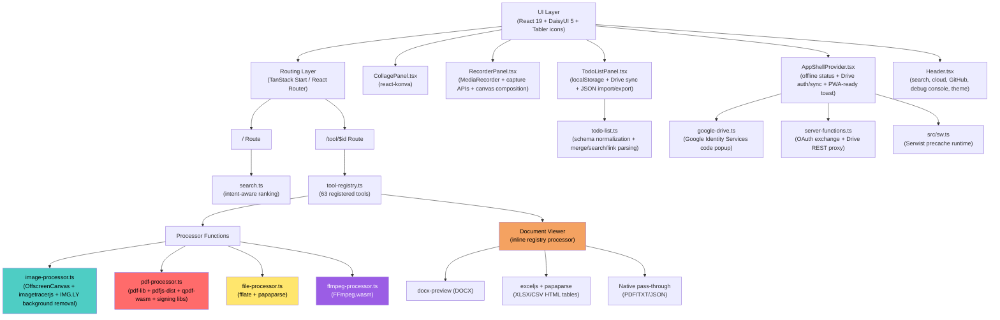

# Kitsy

Kitsy is a local-first toolbox for everyday file, media, document, recorder, and todo workflows. It runs as an offline-capable PWA, keeps file processing on the user's device, and uses a small backend session only for optional Google Drive authorization and upload proxying.

Optional Google Drive support lets users sync the todo list into their own hidden Drive app data and save processed outputs into their own Drive. The app still works local-only when Drive is disconnected, unconfigured, or unavailable.

Useful if you want an offline-friendly alternative to TinyWow, 123apps, Smallpdf, iLovePDF, and similar browser tool services.

> Please consider leaving a star.

---

## Architecture

### Component Overview

### Routing

- `/` renders `src/routes/index.tsx`, reads the `q` search param, ranks all registry tools with `rankToolsByQuery()`, and otherwise groups tools by category.
- `/tool/$id` renders `src/routes/tool.$id.tsx`, looks up the ID with `getToolById()`, and passes the selected tool to `ToolPanel`.
- `src/routes/__root.tsx` owns the app shell, metadata, theme bootstrap, route preloading, and route-specific PWA manifest switching. `/tool/todo-list` uses `/manifest-todo.json`; all other routes use `/manifest.json`.
- There are no per-tool route files.

---

## Tool Model

All tools are objects in `src/lib/tool-registry.ts`. A tool definition contains:

- `id`, `name`, `description`, `category`, `icon`
- `acceptedExtensions` and optional `producedExtensions`
- `multiple`
- optional `requiresFiles`
- optional `uiMode`: `standard`, `auto-process`, `collage`, `recorder`, or `todo`
- `options`
- `process(files, options) => Promise<ProcessedFile[]>`

`ToolPanel` handles file selection, previews, options, processing, result cards, downloads, ZIP download-all, and Drive upload actions for standard tools. Custom UI modes render:

- `auto-process`: runs immediately after file selection; currently used by `document-viewer`.
- `collage`: renders `CollagePanel`.
- `recorder`: renders `RecorderPanel`.
- `todo`: renders `TodoListPanel`.

`batch()` in the registry sequentially applies single-file processors to multi-file tools. Tools like PDF merge and image-to-PDF handle all files as one batch.

`FileDropzone` accepts drag/drop and hidden file input selection. It builds the input `accept` string from `acceptedExtensions`, optional MIME types, and an extra `text/csv` hint for CSV selection on mobile browsers. `ToolCard` shows the first four accepted extensions visually, adds a `+N` badge for the rest, and includes an `sr-only` metadata block with the tool description and accepted extensions.

### Registered Tools

This list matches the current registry.

| Category | Tools |
| --- | --- |
| Image | `image-convert`, `image-resize`, `image-rotate`, `image-crop`, `image-upscale`, `image-collage`, `image-blur`, `image-pixelate`, `image-add-text`, `image-remove-bg` |
| PDF | `pdf-merge`, `pdf-split`, `pdf-delete-pages`, `pdf-reorder`, `pdf-header-footer`, `pdf-bates-numbering`, `pdf-add-blank-pages`, `pdf-remove-blank-pages`, `pdf-crop-pages`, `pdf-overlay-pages`, `pdf-resize-pages`, `pdf-n-up`, `pdf-page-dimensions`, `pdf-sign-visual`, `pdf-digital-sign`, `pdf-validate-signature`, `pdf-lock`, `pdf-unlock`, `pdf-images-to-pdf`, `pdf-to-images`, `pdf-compress`, `pdf-watermark`, `pdf-rotate`, `pdf-flatten`, `pdf-metadata`, `pdf-strip-metadata`, `pdf-remove-annotations` |
| Video | `video-convert`, `video-trim`, `video-extract-audio`, `video-merge`, `video-audio-merge`, `video-mute`, `video-speed`, `screen-recorder`, `camera-recorder`, `video-resize`, `video-crop`, `video-watermark`, `video-extract-frames` |
| Audio | `audio-convert`, `audio-trim`, `audio-merge`, `audio-recorder`, `audio-volume`, `audio-fade` |
| Document | `document-viewer` |
| File | `file-zip`, `file-unzip` |
| Data | `data-csv-to-json`, `data-json-to-csv`, `data-format-json`, `todo-list` |

Current count: 63 tools.

