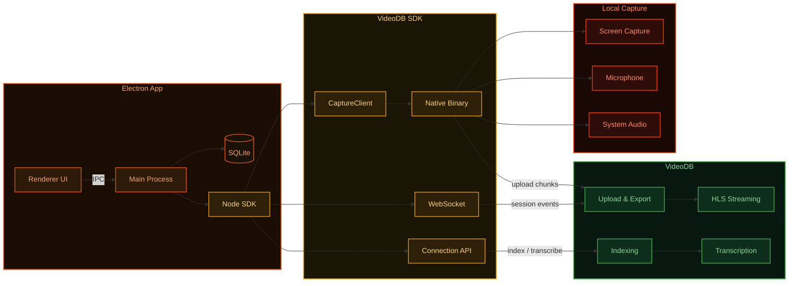

<!-- PROJECT SHIELDS -->
[![Electron][electron-shield]][electron-url]
[![Node][node-shield]][node-url]
[![License][license-shield]][license-url]
[![Stargazers][stars-shield]][stars-url]
[![Issues][issues-shield]][issues-url]
[![Website][website-shield]][website-url]

<!-- PROJECT LOGO -->
<br />
<p align="center">
  <a href="https://videodb.io/"></a>
</p>

<h3 align="center">An open source, agentic Loom alternative.</h3>

<p align="center">
  Record locally. Make recordings AI-ready. Run workflows on top.
  <br />
  <br />
  <strong>Record → Query → Automate</strong>
</p>

<p align="center">
  <a href="#installation">Install</a>
  ·
  <a href="#features">Features</a>
  ·
  <a href="https://docs.videodb.io"><strong>Docs</strong></a>
  ·
  <a href="https://github.com/video-db/bloom/issues">Report Bug</a>
</p>

---

## What is Bloom?

Bloom is a local-first screen recorder built for agentic workflows. 

- **Record locally** — No lock-in, your files stay yours
- **Upload to VideoDB** — Automatic cloud sync with AI processing. 
- **Find any moment** — Transcripts, visual embeddings, metadata.
- **Let agents work on your recordings** — Query via APIs or agent frameworks like Claude Code and access your recordings data.

Recordings are no longer files, they are inputs for AI.

---

## Demo

https://github.com/user-attachments/assets/bf075217-b256-43b7-9369-b5d172bfc6b2

---

## Installation

Run this in your terminal to install Bloom:

```bash
curl -fsSL https://artifacts.videodb.io/bloom/install | bash
```

This will automatically detect your Mac architecture, download the right build, and install it to `/Applications`.

<details>
<summary>Manual install</summary>

- **Apple Silicon (M1/M2/M3/M4)**: [bloom-2.2.0-arm64.dmg](https://artifacts.videodb.io/bloom/bloom-2.2.0-arm64.dmg)
- **Apple Intel**: [bloom-2.2.0-x64.dmg](https://artifacts.videodb.io/bloom/bloom-2.2.0-x64.dmg)
- **Windows**: [bloom-2.2.0-x64.exe](https://artifacts.videodb.io/bloom/bloom-2.2.0-x64.exe)

1. Mount the DMG and drag Bloom to your Applications folder
2. Open Terminal and run `xattr -cr /Applications/Bloom.app`
3. Launch the app from Applications or Spotlight

</details>

<p>
  <em>Supported on macOS and Windows (pre-built installer available for macOS). Linux support coming soon.</em>
</p>

---


## Features

| Feature | Description |
|---------|-------------|
| **No subscription** | Pay only for usage |
| **Local-first** | Record locally, no lock-in |
| **AI-ready** | Search, summarize, extract |
| **Screen recording** | Capture screen, microphone, and system audio via [VideoDB Capture SDK](https://docs.videodb.io) |
| **Camera overlay** | Draggable camera bubble during recording |
| **Floating bar** | Always-on-top control bar that never blocks your apps |
| **Multi-monitor** | Display picker to choose which screen to record |
| **Library** | Browse, search, play, rename, and download recordings |
| **Transcription** | Automatic transcript generation with subtitled playback |
| **Chat with video** | Ask questions about your recording via [VideoDB Chat](https://chat.videodb.io) |
| **Share** | One-click shareable link for any recording |
| **Keyboard shortcut** | `Cmd+Shift+R` to start/stop recording from anywhere |
| **Open source** | Fully customizable UI layer |

---


## Architecture

```
Bloom = UI layer (open source)
VideoDB = Intelligence layer (cloud)
```



**Recording flow:** The app creates a `CaptureClient` which spawns a native binary to capture screen, mic, and system audio. Chunks are uploaded to VideoDB Cloud in real-time. A WebSocket connection delivers session events (started, stopped, exported) back to the app.

**Post-recording:** Once the video is exported, the app calls the VideoDB API to index spoken words, generate a transcript, and create a subtitled stream — all available for in-app HLS playback or sharing via URL.

---

## Open source

The UI layer is fully open source.

- **Modify it** — Customize the interface to your needs
- **Extend it** — Add new features and workflows
- **Plug it in** — Integrate with your own systems

Bloom is not just a tool. It's a foundation for building agentic systems on top of recordings.

---

## Ph